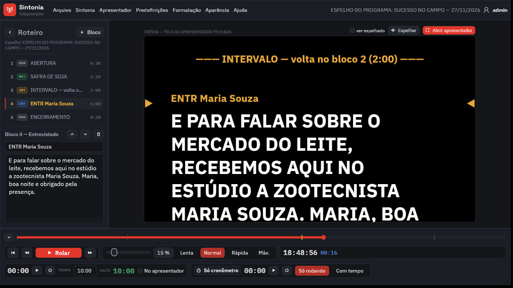

# Sintonia Teleprompter

Teleprompter para **Windows, macOS e Linux**, feito em **Rust**, com a cara do
**Sintonia** e integrado a ele: entra com o mesmo usuário e senha do sistema e
abre direto o **Espelho** do programa — cada item do espelho vira um bloco de
leitura (matérias, entrevistados, itens manuais e as marcações de intervalo).
Também abre e salva **TXT**, inclusive os arquivos do teleprompter antigo
(Apotec), com `//` separando laudas e `<<` `>>` marcando destaque.



## Como funciona

- **Duas telas**: a do **operador** (roteiro, edição, formatação, prévia e
  controles) e a do **apresentador** (só o texto, grande, que vai no monitor
  do teleprompter — pode ser espelhada para o vidro).
- **Abrir espelho**: escolha o dia com ◀ ▶ (ou Hoje / Amanhã), filtre pelo
  programa e veja os itens do espelho antes de abrir. Num dia sem espelho, o
  programa mostra os dias mais próximos que têm.
- **Login do Sintonia**: as mesmas permissões do site valem aqui — quem só tem
  "Visualizar" no Espelho lê; quem tem "Editar" pode gravar no espelho os
  textos corrigidos no teleprompter.
- **Edição na hora**: o texto pode ser corrigido durante o programa; a tela do
  apresentador atualiza na mesma hora. "Sintonia → Gravar textos alterados no
  espelho" manda as correções de volta (aparece no Histórico do Sintonia).
- **Formatação**: fonte (as do Sintonia ou qualquer fonte instalada no
  computador), negrito, tamanho, espaço entre linhas, margem, alinhamento,
  CAIXA ALTA, cores do texto/fundo/títulos/destaque, seta de leitura.
- **Velocidade** de 0 a 100 %, com botões prontos (Lenta, Normal, Rápida,
  Máx.). Para **passar rápido** um trecho, segure ⏩ (ou ⏪ para voltar), o
  botão direito do mouse sobre o texto, ou Shift + ↓. A barra vermelha acima
  dos controles mostra onde está o texto; clique nela para ir direto.
- **Formatação** fica escondida para a prévia ter mais espaço: abra pelo
  botão **Formatação** no menu de cima.
- **Predefinições**: salve a formatação com um nome (ex.: "Jornal da Noite") —
  fonte, tamanho, cores, espelhamento, velocidade, **monitor e tela cheia do
  apresentador** — e troque tudo de uma vez pelo menu **Predefinições**.
- **Cronômetro**: dispara sozinho quando o texto começa a rolar (Home zera),
  contagem regressiva do **tempo do programa** (preenchido sozinho com a soma
  das durações do espelho), **estimativa do tempo de leitura** que falta e
  relógio. Para o apresentador ver o cronômetro no canto da tela dele, marque
  **Mostrar ao apresentador** (vem desligado).
- **Tela só cronômetro** (entrevistas): troca o texto do apresentador por um
  cronômetro grande no meio da tela, com cronômetro próprio, de dois jeitos:
  **Só rodando** (conta para cima, sem limite) ou **Com tempo** (regressivo a
  partir da duração — preenchida sozinha quando o bloco atual é um entrevistado
  do espelho; fica verde, âmbar no último minuto e, quando estoura, a tela
  pisca em vermelho mostrando o tempo a mais, ex.: +00:15).
- **Só o cronômetro**: na tela de entrada, "Usar só o cronômetro" abre direto
  a tela do apresentador com o cronômetro, sem login e sem texto.
- **Lembrar login**: marcado, o programa guarda usuário e senha. A senha vai
  para o cofre de senhas do sistema (Gerenciador de Credenciais do Windows,
  Chaveiro do Mac), nunca para arquivo de texto.
- **Tema escuro e claro**, iguais aos do Sintonia.


## Atalhos (os mesmos do Apotec)

| Tecla / mouse | O que faz |
|---|---|
| Espaço · clique no texto | rolar / parar |
| End · clique na rodinha | para a rolagem |
| ↑ / ↓ (segurar) · arrastar o texto | rola o texto na mão |
| → / ← · rodinha do mouse | velocidade +5 % / −5 % (com Shift, 1 %; vai de 0 a 100 %) |
| Segurar ⏩ / ⏪ · segurar o botão direito no texto · Shift + ↓ / ↑ | passa rápido (para a frente / para trás) |
| Home | volta ao começo e zera o cronômetro |
| Page Up / Page Down | lauda (bloco) anterior / próxima |
| F5 | inicia / pausa o cronômetro |
| F6 | inicia / pausa o cronômetro da entrevista |
| F7 | tela só cronômetro (liga / desliga) |
| F11 / Esc | tela cheia do apresentador (liga / desliga) |

## Formato do TXT

```
# ABERTURA
Boa noite! Começa agora o Sucesso no Campo.
<<
Este trecho aparece na cor de destaque.
>>
# SAFRA DE SOJA
A colheita da soja avança no estado...
```

- `# TÍTULO` abre um bloco novo com aquele título (retranca).
- `//` também separa blocos (laudas), como no Apotec — os blocos sem título
  viram "LAUDA 1", "LAUDA 2"... (`http://` não conta como separador).
- `<<` e `>>` marcam texto em destaque.
- Arquivos em UTF-8 ou no formato antigo do Windows (ANSI/Latin-1) abrem com
  os acentos certos. Ao salvar, o app grava em UTF-8 usando `#`.

## Uso com dois monitores

1. Ligue o monitor do teleprompter como **tela estendida**.
2. Clique em **Abrir tela do apresentador**.
3. Em "Tela do apresentador", escolha o **Monitor** (0 = principal, 1 =
   segundo...) e marque **Tela cheia** (ou aperte F11 com a janela dele
   ativa). Se o monitor fica atrás de um vidro, marque **Espelhar horizontal**.

A prévia na tela do operador mostra exatamente a mesma quebra de linhas da
tela do apresentador (mesma proporção), sem espelhar.

## Instalação

Baixe o pacote do seu sistema na página de **Releases** do repositório
(gerado automaticamente pelo GitHub Actions a cada versão):

- **Windows**: `sintonia-teleprompter-windows-x64.zip` → descompacte e abra
  `Sintonia Teleprompter.exe`.
- **macOS** (Intel e Apple Silicon): `sintonia-teleprompter-macos-universal.zip`
  → arraste o app para Aplicativos. Na primeira vez, clique com o botão
  direito → Abrir (o app ainda não é assinado pela Apple).
- **Linux**: `sintonia-teleprompter-linux-x64.tar.gz` → descompacte e rode
  `./instalar.sh`. Precisa de `libxkbcommon-x11-0` e `libgl1`
  (`sudo apt install libxkbcommon-x11-0 libgl1`).

Na primeira tela, informe o endereço do servidor do Sintonia (o mesmo do
navegador, ex.: `http://servidor:3001`), usuário e senha. O endereço e o
usuário ficam salvos; a senha, nunca.

## Compilar

Precisa do [Rust](https://rustup.rs) (stable).

```bash
cargo run              # roda em modo desenvolvimento
cargo test             # testes
cargo build --release  # executável final em target/release/
```

No Linux, para compilar: `sudo apt install libxkbcommon-dev libwayland-dev libgl1-mesa-dev`.

## Agentes de IA do projeto

A pasta [`.claude/agents`](.claude/agents) tem agentes prontos para usar com o
Claude Code neste repositório:

| Agente | Para quê |
|---|---|
| `dev-rust` | implementar funcionalidades e corrigir bugs no código Rust |
| `integracao-sintonia` | tudo que envolve a API do Sintonia (login, espelho, permissões) |
| `design-sintonia` | manter a identidade visual do Sintonia nas telas |
| `qa-teleprompter` | testar de verdade: sobe um Sintonia local, abre o app e tira prints |
| `release-multiplataforma` | builds de Windows/macOS/Linux, pacotes e versões |
| `revisor-lauda` | revisar textos para leitura no ar (ritmo, números, siglas, tempo) |

Regras gerais do projeto para a IA: [`CLAUDE.md`](CLAUDE.md). Organização do
código: [`docs/ARQUITETURA.md`](docs/ARQUITETURA.md).

## Fontes e ícone

As fontes IBM Plex Sans, IBM Plex Mono e Space Grotesk (as mesmas do site do
Sintonia) vão embutidas no programa, sob a licença SIL Open Font License
(`assets/fonts/OFL-*.txt`). O ícone é o mesmo do Sintonia.
